<p align="center">
  
</p>

# 📊 Awesome Enterprise Digital Analytics Ecosystem 🌐

<p align="center">
  <a href="https://github.com/ishandutta2007/Awesome-Awesome-Awesome"></a><a href="https://discord.gg/jc4xtF58Ve"></a><a href="https://github.com/ishandutta2007/Awesome-Enterprise-Digital-Analytics/stargazers"></a><a href="https://github.com/ishandutta2007/Awesome-Enterprise-Digital-Analytics/network/members"></a><a href="https://github.com/ishandutta2007/Awesome-Enterprise-Digital-Analytics/blob/main/LICENSE"></a><a href="https://github.com/ishandutta2007"></a>
</p>

---

## 📌 Ecosystem Overview & SEO Index

Welcome to the definitive architectural index of **Enterprise SaaS Platforms** and **Open-Source Behavioral Data Engines** for **Digital Analytics**, **Web Analytics**, **Product Analytics**, **Customer Data Platforms (CDPs)**, **Session Replay & Digital Experience Analytics (DXA)**, and **Privacy-First Telemetry**.

Modern enterprises demand reliable behavioral intelligence across web applications, mobile platforms, and customer touchpoints. With tightening global data privacy regulations (GDPR, CCPA, HIPAA, PECR), third-party cookie deprecation, and the rise of data-warehouse-native architectures (Snowflake, BigQuery, ClickHouse), organizations face critical architectural trade-offs:
- **Hosted Cloud & Enterprise SaaS:** Turnkey compliance, advanced machine-learning attribution, enterprise SLAs, and seamless marketing cloud integrations.
- **Self-Hosted Open-Source Frameworks:** 100% data sovereignty, zero egress surveillance, unlimited data retention, and custom behavioral event pipeline control.

This curated list provides technical decision-makers, platform architects, engineering leads, and product teams with transparent comparisons of pricing, free tiers, scale, and feature capabilities.

---

## 📑 Table of Contents

- [🌐 Sector Overview & Market Dynamics](#-sector-overview--market-dynamics)
- [🏢 SaaS & Hosted Enterprise Platforms](#-saas--hosted-enterprise-platforms)
- [🔓 Open-Source GitHub Projects](#-open-source-github-projects)
- [🧩 Architectural Comparison: SaaS vs. Self-Hosted](#-architectural-comparison-saas-vs-self-hosted)
- [🤝 How to Contribute](#-how-to-contribute)
- [💖 Support & Sponsorship](#-support--sponsorship)
- [📈 Star History](#-star-history)
- [⚠️ Disclaimer](#%EF%B8%8F-disclaimer)

---

## 🌐 Sector Overview & Market Dynamics

> 💡 **Market Insights:** The global digital analytics market was valued at **$18.5 Billion in 2024–2025** and is projected to expand to **$48.2 Billion by 2030–2032** at a Compound Annual Growth Rate (CAGR) of **~17.4%**. 
> 
> The sector exhibits a **bimodal, moderately concentrated structure** at the mega-enterprise infrastructure layer—anchored by dominant multi-cloud ecosystems (Google Analytics 360 and Adobe Analytics) capturing broad ad-tech attribution—while simultaneously demonstrating **accelerating fragmentation across specialized verticals**. High-growth niches in product analytics (Amplitude, Mixpanel), behavioral session intelligence (Contentsquare, FullStory), and privacy-first open-core platforms (PostHog, Matomo, Piwik PRO) are disrupting monolithic suites as enterprises prioritize cookieless telemetry, first-party data capture, and European data sovereignty.

---

## 🏢 SaaS & Hosted Enterprise Platforms

The table below catalogs premier commercial digital analytics suites, ranked strictly in descending order of enterprise company scale (**Market Capitalization / Corporate Valuation / Annual Recurring Revenue**).

| 🏢 Platform | 💰 Company Size (Valuation / Revenue) | 🏷️ Starting Paid Tier | 🎁 Free Tier / Trial Limit | 🚀 Key Capabilities & Enterprise Focus |
| :--- | :--- | :--- | :--- | :--- |
| **[Google Analytics 360](https://marketingplatform.google.com/about/analytics-360/)** | **$2.1T+ Market Cap** ($307B Alphabet Revenue) | **$50,000 / yr (~$4,166 / mo)** (GA4 360 entry tier up to 25M monthly events) | **100% Free Forever** (GA4 Standard: 10M events/property/mo, 14-mo exploration retention, BigQuery streaming export) | Enterprise multi-channel digital analytics natively integrated with Google Ads, Search Ads 360, Display & Video 360, and BigQuery ML. |
| **[Adobe Analytics](https://business.adobe.com/products/analytics/adobe-analytics.html)** | **$220B+ Market Cap** ($21.5B Adobe Revenue) | **$2,000 / mo (~$24,000 / yr)** (Select tier entry contract based on annual server-call volume) | **30-day guided enterprise sandbox trial** (Up to 5M test server calls via enterprise sales; no perpetual free tier) | Gold-standard enterprise digital marketing analytics with Customer Journey Analytics (CJA), multi-touch attribution, and Adobe Experience Platform CDP. |
| **[Contentsquare](https://contentsquare.com/)** | **$5.6B Valuation** ($1.4B total funding raised) | **$39 / mo** (Self-serve Growth tier; custom enterprise contracts based on session volume) | **200,000 sessions / mo Free Forever** (Includes 10,000 session replays/mo, zone-based heatmaps, plus 15-day Growth plan trial) | Digital experience analytics (DXA), automated UX friction scoring, journey mapping, and session replay (merged with Heap). |
| **[FullStory](https://www.fullstory.com/)** | **$1.8B Valuation** ($172M total funding raised) | **$800 / mo (~$9,600 / yr)** (Business tier covering up to 50,000 monthly sessions) | **14-day free trial** (Full feature access up to 10,000 sessions; free companion tier covers 1,000 sessions/mo) | Behavioral data platform capturing complete digital interactions, rage clicks, error diagnostics, and conversion funnel drop-offs. |
| **[Amplitude](https://amplitude.com/)** | **$1.4B Market Cap** (NASDAQ: AMPL; ~$290M ARR) | **$49 / mo** (Plus plan for up to 2.5M events/mo; pay-as-you-go scaling up to 70M events/mo) | **2,000,000 events / mo Free Forever** (Starter plan with unlimited team seats, core product analytics, and 10,000 session replays/mo) | Industry-standard product analytics suite specializing in behavioral cohorts, funnel retention analysis, feature engagement, and predictive scoring. |
| **[PostHog (Cloud)](https://posthog.com/)** | **$1.4B Valuation** ($85M funding, ~$25M+ ARR) | **$0.00030 / event** (Pay-as-you-go metered billing with $0 minimum commitment) | **1,000,000 events / mo Free Forever** (Plus 5,000 session replays/mo, 250 survey responses/mo, feature flags, and unlimited team seats) | Developer-centric product engineering platform combining event tracking, session recording, user heatmaps, feature flags, and SQL warehouse queries. |
| **[Heap](https://heap.io/)** | **$1.4B Acquisition** (Acquired by Contentsquare; $2.1B prior valuation) | **$300 / mo (~$3,600 / yr)** (Growth tier with Sense AI assistant and 12-month data retention) | **10,000 sessions / mo Free Forever** (Autocapture-enabled core charts, 6 months data retention, funnels, and Single Sign-On) | Autocapture-native product analytics indexing every click, swipe, and pageview automatically without manual instrumentation code. |
| **[Mixpanel](https://mixpanel.com/)** | **$1.05B Valuation** ($277M funding raised) | **$28 / mo** (Growth plan billed annually for 10k MTUs, or $100/mo for 1.5M events/mo with unlimited reports) | **1,000,000 events / mo Free Forever** (Starter tier includes unlimited team seats, 10,000 session replays/mo, and 1,000 experiment users) | Event-based product analytics focused on interactive self-serve funnels, retention cohorts, flows, and warehouse-native bi-directional sync. |
| **[Piwik PRO](https://piwik.pro/)** | **~$25M ARR** (Private; backed by Enterprise Investors) | **€35 / mo (~$38 / mo)** (Business plan; Enterprise tier starts at €366/mo billed annually) | **30-day free trial** (Full access to 2,000,000 actions/mo, 20 domains, EU/HIPAA cloud hosting, and integrated Consent Manager; no credit card required) | Privacy-first analytics suite with integrated Tag Manager, Customer Data Platform (CDP), and Consent Management Platform compliant with GDPR/HIPAA. |
| **[Matomo Cloud](https://matomo.org/)** | **~$20M ARR** (InnoCraft; profitable & bootstrapped) | **€19 / mo (~$21 / mo)** (Matomo Cloud entry tier for 50,000 monthly pageviews) | **21-day free trial** (Full Matomo Cloud access with heatmaps, session recording, form analytics; or self-hosted Matomo is 100% free forever) | Comprehensive privacy-compliant Google Analytics alternative providing 100% data ownership, cookieless tracking, heatmaps, and form analytics. |
| **[Woopra](https://www.woopra.com/)** | **~$8M ARR** (Private / Bootstrapped) | **$999 / mo** (Pro tier covering 5 million events/month with 2 years data retention and 50 seats) | **30-day free trial** (Full Pro access up to 5,000,000 events/month; legacy Core tier covers 500,000 actions/mo with 90-day retention) | Real-time customer journey analytics and end-to-end user lifecycle profiling across web, mobile, email, and CRM touchpoints. |
| **[Countly (Flex Cloud)](https://countly.com/)** | **~$6M ARR** (Private / Bootstrapped) | **$175 / mo** (Countly Flex Tier 5K for up to 5,000 MAU and 5 million monthly data points) | **14-day free trial** (Countly Flex Managed Cloud trial; or Countly Community Edition is 100% free forever self-hosted with unlimited data) | Mobile and web product analytics platform with in-app behavioral tracking, push notification campaigns, crash diagnostics, and strict data residency. |

---

## 🔓 Open-Source GitHub Projects

The table below lists the premier open-source, self-hosted alternatives to commercial digital analytics and behavioral intelligence platforms.

*(Sorted strictly descending by GitHub Star Count)*

| 📦 Repository & Link | ⭐ Stars Badge | 🛠️ Primary Capabilities & Focus Area |
| :--- | :--- | :--- |
| **[PostHog](https://github.com/PostHog/posthog)** | [](https://github.com/PostHog/posthog/stargazers) | **All-in-One Product Analytics Suite:** Self-hosted or cloud product platform offering event tracking, session replay, feature flags, A/B testing, user cohorts, and ClickHouse-powered analytics. Open-source alternative to Mixpanel, Amplitude, and FullStory. |
| **[Umami](https://github.com/umami-software/umami)** | [](https://github.com/umami-software/umami/stargazers) | **Privacy-Focused Web Analytics:** Fast, lightweight, and modern Node.js/Next.js analytics solution with clean UI. Does not use cookies, complies fully with GDPR/CCPA, and collects zero personal data. Lightweight alternative to Google Analytics. |
| **[Plausible Analytics](https://github.com/plausible/analytics)** | [](https://github.com/plausible/analytics/stargazers) | **Lightweight Cookieless Analytics:** Elixir & ClickHouse-powered open-source website analytics tool. Script is under 1 KB, requires no cookie banners, and displays essential web telemetry metrics on a single-page dashboard. |
| **[Matomo](https://github.com/matomo-org/matomo)** | [](https://github.com/matomo-org/matomo/stargazers) | **Enterprise Full-Featured Web Analytics:** The leading battle-tested open-source Google Analytics alternative with full data ownership. Features built-in Tag Manager, heatmaps, session recording, funnel analysis, and multi-attribution modeling. |
| **[Highlight](https://github.com/highlight/highlight)** | [](https://github.com/highlight/highlight/stargazers) | **Fullstack Session Replay & Telemetry:** Open-source monitoring and session replay platform with network recording, front-end error tracking, and backend OpenTelemetry tracing. Open-source alternative to FullStory and LogRocket. |
| **[OpenPanel](https://github.com/Openpanel-dev/openpanel)** | [](https://github.com/Openpanel-dev/openpanel/stargazers) | **Modern Product & Web Analytics:** Next-generation, privacy-first open-source analytics platform built for modern applications with full event streaming, user profiles, and clean data visualization. Alternative to Mixpanel. |
| **[Snowplow](https://github.com/snowplow/snowplow)** | [](https://github.com/snowplow/snowplow/stargazers) | **Enterprise Behavioral Data Engine:** Industrial-grade behavioral data collection platform that streams real-time, schematized event telemetry directly into enterprise data warehouses (Snowflake, BigQuery, Redshift). Alternative to Adobe Analytics and GA360 data pipelines. |
| **[GoatCounter](https://github.com/arp242/goatcounter)** | [](https://github.com/arp242/goatcounter/stargazers) | **Minimalist Web Analytics:** Ultra-lightweight Go application providing privacy-respecting web stats without tracking personal identifiers. Can be compiled into a single binary with zero external dependencies. |
| **[Countly Server](https://github.com/Countly/countly-server)** | [](https://github.com/Countly/countly-server/stargazers) | **Mobile & Web Product Analytics:** Enterprise-grade mobile, web, and desktop analytics platform supporting rich behavioral events, crash reports, push notification triggers, and on-premise data residency. |
| **[Jitsu](https://github.com/jitsucom/jitsu)** | [](https://github.com/jitsucom/jitsu/stargazers) | **Open-Source Event Streaming & Ingestion:** High-throughput behavioral data ingestion engine and event router. Captures web/mobile events and streams them with schema management to ClickHouse, Postgres, and BigQuery. Alternative to Segment and RudderStack. |
| **[Ackee](https://github.com/electerious/Ackee)** | [](https://github.com/electerious/Ackee/stargazers) | **Node.js Self-Hosted Analytics:** Privacy-first analytics tool with a minimalist dashboard and GraphQL API. Evaluates site traffic without collecting personal data or setting cookies. |
| **[RudderStack Server](https://github.com/rudderlabs/rudder-server)** | [](https://github.com/rudderlabs/rudder-server/stargazers) | **Enterprise Customer Data Platform (CDP):** Warehouse-first customer data infrastructure for collecting, standardizing, and routing event telemetry to downstream analytics, CRM, and cloud data warehouses. |
| **[Shynet](https://github.com/milesmcc/shynet)** | [](https://github.com/milesmcc/shynet/stargazers) | **Zero-Cookie Web Analytics:** Modern, privacy-friendly web analytics built with Python/Django and PostgreSQL. Operates reliably without cookies and even functions when JavaScript is disabled using pixel tracking. |
| **[Open Web Analytics (OWA)](https://github.com/Open-Web-Analytics/Open-Web-Analytics)** | [](https://github.com/Open-Web-Analytics/Open-Web-Analytics/stargazers) | **Classic Self-Hosted Web Analytics:** Battle-tested PHP/MySQL analytics framework providing pageview tracking, click heatmaps, conversion goal monitoring, and e-commerce reporting. |
| **[Aptabase](https://github.com/aptabase/aptabase)** | [](https://github.com/aptabase/aptabase/stargazers) | **Mobile & Desktop App Analytics:** Privacy-first, open-source analytics platform purpose-built for client applications across Flutter, React Native, Swift, Kotlin, Electron, and Tauri. |
| **[Swetrix](https://github.com/Swetrix/swetrix)** | [](https://github.com/Swetrix/swetrix/stargazers) | **Cookieless Web & Event Telemetry:** Fully open-source web analytics service featuring live visitors, custom event conversion tracking, user flow funnels, and front-end performance monitoring. |

---

## 🧩 Architectural Comparison: SaaS vs. Self-Hosted

Choosing between an enterprise hosted SaaS and a self-hosted open-source telemetry engine requires aligning organizational compliance, scale, and engineering resources:

```
┌───────────────────────────────────────────────────────────────────────────┐
│                      DIGITAL ANALYTICS SPECTRUM                           │
├─────────────────────────────────────┬─────────────────────────────────────┤
│      ENTERPRISE SAAS / HOSTED       │       OPEN-SOURCE / SELF-HOSTED     │
│  (GA4 360, Adobe, Mixpanel, Heap)   │  (PostHog, Umami, Matomo, Snowplow) │
├─────────────────────────────────────┼─────────────────────────────────────┤
│ ⚡ Zero operational server overhead │ 🛡️ 100% Data Sovereignty & Isolation│
│ 🎯 Deep ad-network attribution      │ 💰 Zero per-event vendor lock-in tax│
│ 🤝 Enterprise SLAs & SOC2 support   │ 🔍 Full auditability of code & DB   │
│ ⚠️ Subject to third-party data regs │ 🛠️ Requires infra / DB management  │
└─────────────────────────────────────┴─────────────────────────────────────┘
```

- **🚀 For High-Growth Product Teams:** Deploy **PostHog** or **Mixpanel** for fast behavioral cohorting, funnel conversion diagnostics, and product engagement analysis.
- **🛡️ For Strict Privacy & Cookieless Compliance (GDPR/HIPAA):** Adopt **Umami**, **Plausible**, or **Matomo** to eliminate cookie banner requirements and maintain complete data residency.
- **🏢 For Enterprise Warehouse-Native Data Infrastructure:** Leverage **Snowplow** or **RudderStack** to pipe validated, schematized event streams directly into your Snowflake, ClickHouse, or BigQuery data lakehouse.
- **🔍 For Friction Analysis & UX Session Replay:** Choose **Contentsquare**, **FullStory**, or self-hosted **Highlight** to reproduce user interactions down to the individual DOM mutation.

---

## 🤝 How to Contribute

Contributions from data architects, analytics engineers, and product teams are warmly encouraged!

1. 🍴 **Fork** this repository.
2. 📝 **Add or update** entries in `README.md` following the established table structure and sorting criteria.
3. 🔎 **Verify factual accuracy:** Ensure starting prices, free tier allowances, company valuations, and star badges are thoroughly verified.
4. 🚀 **Submit a Pull Request** with a clear explanation of additions.

For related developer toolkits and curated ecosystem resources, explore the master catalog at [Awesome-Awesome-Awesome](https://github.com/ishandutta2007/Awesome-Awesome-Awesome).

---

## 💖 Support & Sponsorship

Thank you for exploring **Awesome Enterprise Digital Analytics**! If this curated guide assists you in architecting, choosing, or deploying enterprise digital analytics infrastructure, please consider supporting the project:

- ⭐ **Star this repository** on GitHub to help other engineers, data leaders, and product architects find it!
- 🍴 **Fork & Share** with your technical peers, team members, and data communities.
- ☕ **Support the Maintainer** on GitHub Sponsors or buy a coffee to fuel ongoing open-source curation and research:

<p align="left">
  <a href="https://github.com/sponsors/ishandutta2007">
    
  </a>
</p>

---

## 📈 Star History

[](https://star-history.dera.page/#ishandutta2007/Awesome-Enterprise-Digital-Analytics&type=date&legend=top-left)

---

## ⚠️ Disclaimer

- This catalog is a **community-curated index** published for architectural evaluation and decision-making purposes.
- Commercial pricing tiers, feature quotas, and terms of service fluctuate over time; always confirm directly with respective vendors prior to contracting.
- Behavioral event collection may involve sensitive customer personally identifiable information (PII). Ensure appropriate data masking, consent governance, and encryption controls across all implementations.

---

<p align="center">
  <b>Built for analytics engineers, platform architects, and digital product leaders shaping modern behavioral telemetry.</b>
</p>
